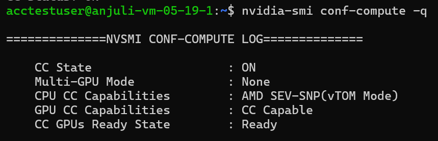

# Frequently Asked Questions

Below are a list of frequently asked questions and answers.

## Q: How can I get quota for creating an NCC CGPU VM?

A: Details for the specific process to be granted quota for an NCC CGPU VM can be found on the [CGPU Quota](docs/CGPU-Quota.md) page.


## Q: How can I capture an image of my CGPU VM and share it?

A: There are separate instructions for creating and sharing virtual machine images (VMIs) for within-subscription and across-subscription use cases. Please refer to the document that is applicable to your situation: 

1. [Internal VMI Creation And Sharing Instructions](docs/Internal-VMI-Creation-And-Sharing-Instructions.md): used within the same subscription
2. [External VMI Creation And Sharing Instructions](docs/External-VMI-Creation-And-Sharing-Instructions.md): used between different subscriptions


## Q: Which GPU verifier is being used?

A: By default, updated NCC H100 onboarding packages for Ubuntu 22.04 and 24.04 use NVIDIA's C++ `nvattest`. However, existing gallery images and older packages are not automatically migrated and may still use Python. For now, the legacy Python verifier is located here: [legacy Python verifier](./src/legacy_local_gpu_verifier/README.md), however we highly recommend migrating dependent workflows over to the new `nvattest` verifier.

To explicitly select Python GPU attestation, run this from the extracted updated onboarding package in the VM:

```bash
sudo bash utilities-legacy-local-gpu-verifier.sh
```

This runs Python GPU attestation locally and does not replace `gpu-attestation`. To install or refresh the default `nvattest` command, run the root step 2 from that package:

```bash
sudo bash step-2-attestation.sh --gpu-only
```


## Q: How can I uninstall the GPU driver?

A: Obtain the [latest onboarding package](https://github.com/Azure/az-cgpu-onboarding/releases/latest) that contains `utilities-uninstall-gpu-stack.sh`. Save work, stop all GPU workloads and containers, and prevent them from restarting during maintenance.

Inside the VM, enter the extracted package and preview the cleanup:

```bash
cd ~/cgpu-onboarding-package
sudo bash utilities-uninstall-gpu-stack.sh --dry-run
```

Review the selected packages and commands. Cleanup is noninteractive and removes the onboarding driver, attestation tools, Docker/containerd, and GPU tools, not just the driver. OS kernels and step-0 holds, container/model data, package-local logs, and shared Conda are preserved by default.

Run the cleanup:

```bash
sudo bash utilities-uninstall-gpu-stack.sh
```

The utility itself does not reboot. After cleanup succeeds, reboot the guest separately, then reconnect over SSH after it finishes booting. If cleanup fails, keep workloads stopped and retain the logs. Review custom Docker settings before resuming containers after reinstallation.


## Q: How can I check my driver version and update it?

A: Check the installed driver version:
```bash
nvidia-smi
```

For **either a GPU-driver or Linux-kernel update**, [uninstall the current GPU stack first](#q-how-can-i-uninstall-the-gpu-driver), including the guest reboot above. Do not substitute an in-place `apt upgrade`.

Obtain the [latest onboarding package](https://github.com/Azure/az-cgpu-onboarding/releases/latest), then follow its supported steps 0-3 in order, stopping on errors:

1. Prepare the kernel with `sudo bash step-0-prepare-kernel.sh`. Without a snapshot argument, it clears the previous onboarding snapshot selection and uses current repositories. Step 0 reboots automatically; wait for boot and reconnect over SSH.
2. Re-enter the package directory and run `sudo bash step-1-install-gpu-driver.sh`, then `sudo bash step-2-attestation.sh`, then `sudo bash step-3-install-gpu-tools.sh`, one at a time.
3. Before resuming workloads, confirm the driver, H100 visibility, Secure Boot, CC ON/PRODUCTION, successful `sudo cpu-attestation` and `sudo gpu-attestation`, and step 3's container/DCGM checks.


## Q: My CGPU driver stopped working after an unattended update, how can I fix it?

A: There is an NVIDIA driver/library version mismatch which can cause a failure if you are running certain NVIDIA driver versions when your machine runs an unattended upgrade. Possible error messages you may see if this is the case are: 

`Failed to initialize NVML: Driver/Library version mismatch` or 

`NVIDIA-SMI has failed because it couldn't communicate with the NVIDIA driver. Make sure that the latest NVIDIA driver is installed and running.`

Follow the [uninstall procedure](#q-how-can-i-uninstall-the-gpu-driver) to remove the current onboarding stack and reboot the guest after successful cleanup, then follow the [driver/kernel update steps](#q-how-can-i-check-my-driver-version-and-update-it) to reinstall and validate before resuming workloads.


## Q: How can I re-enable Unattended-Upgrades?

A: By default, Unattended-Upgrades and periodic package-list refreshes are disabled through our onboarding script. Unattended-Upgrades is a package for Ubuntu that allows the automatic installation of security updates. This means that critical updates are installed without user intervention, but these installations can cause potential runtime service interruptions to currently running workloads and attestation.

If you would like to re-enable unattended upgrades on your VM, please run:
```bash
sudo rm -f /etc/apt/apt.conf.d/99-cgpu-disable-list-refresh
sudo apt-get update
sudo apt install unattended-upgrades
```


## Q: How can I use OpenSSL `(>=3.1.0)` for Confidential H100 GPU bandwidth improvement?

OpenSSL version 3.1.0 and above are known to significantly improve the bandwidth between H100 Confidential GPU and CPU, thanks to the encryption performance boost provided by AVX512.

We have created a script to build and install OpenSSL 3.4.1 to `/opt/openssl` where you have the option to specify the `LD_LIBRARY_PATH` to `/opt/openssl/lib64`. Note that the system's OpenSSL 3.0.2 remains untouched and continues to be the default version.

Run the following command to install it: 
```
sudo bash utilities-install-openssl.sh
```
For more specifics on H100 GPU bandwidth using the different versions of SSL, refer to the [OpenSSL-Details](docs/OpenSSL-Details.md) page.


## Q: How can I deploy my CGPU VM manually if I don't want to run the auto-onboarding scripts?

A: We have detailed out the options to deploy a CGPU VM manually [here](docs/Confidential-GPU-H100-Manual-Installation-(PMK-for-Windows).md). It also contains the following steps needed to fully set up the CGPU environment in order to run a sample workload.


## Q: Why does the `dmesg` not display `AMD SEV-SNP`?

A: This is the intended behavior because the AMD SEV-SNP offering on Azure runs in the vTOM (virtual Top of Memory) mode and the SEV-SNP CPUID capability is not exposed to the VM, though SEV-SNP is in use. In such a CVM, the native attestation interface /dev/sev-guest is unsupported; instead, the VM should perform attestation via vTPM.

To detect such an AMD SEV-SNP VM on Azure, a user can check the CPU leaves below:
CPUID leaf 0x40000003’s EBX.bit22 is 1 AND
CPUD leaf 0x4000000C’s EAX.bit0 is 1, and EBX.bit 0~3 is 2.
(refer to https://elixir.bootlin.com/linux/latest/source/arch/x86/kernel/cpu/mshyperv.c#L445)

Alternatively, to verify the CPU's confidential computing capabilities using nvidia-smi use the following command: `nvidia-smi conf-compute -q`

You should see something similar to the following, showing the `AMD SEV-SNP (vTOM Mode)` enabled in the conf-compute log: 


## Q: How can I check my CGPU VM's HyperV SEV-SNP status is enabled?

A: Use the following command to check the HyperV SEV-SNP enablement on your machine: 
```
sudo apt-get update
sudo apt install cpuid
cpuid -l 0x4000000C -1 | awk '$4 ~ /^ebx=.*2$/ { print "AMD SEV-SNP is enabled"}'
```

For more detailed information on how to perform guest attestation for Azure SEV-SNP CVM, please refer to the following page: [SNP Guest Attestation](docs/SNP-Guest-Attestation-Verification.md)


## Q: Can I get NVMe support for my CGPU VM?

A: NVMe support is currently not supported for CGPU VMs, but this feature is being worked on for future releases. There are bugs that show NVMe attachment support when creating CGPU VMs from the Azure portal which we are working to resolve.


## Q: I am an existing customer, what updates do I need to know about?
 
A: **May 6, 2025:**
For the following Nvidia drivers, there could be attestation failure. Customers need to update to driver >= r550.127.05 to mitigate. For details check the link [NVIDIA SecureAI Attestation Advisory: HBM3 Resiliency Impact on Driver Versions r550.0-r550.90.12 - NVIDIA Docs](https://docs.nvidia.com/attestation/secureai-advisory-hbm3-resiliency-impact-on-driver-versions-r550-0-r550-90-12/index.html)

- NV_GPU_DRIVER_GH100_550.54.14
- NV_GPU_DRIVER_GH100_550.54.15
- NV_GPU_DRIVER_GH100_550.90.07
- NV_GPU_DRIVER_GH100_550.90.12
- NV_GPU_DRIVER_GH100_550.113

**Dec. 4, 2024:** 
Unattended-upgrades package has been removed by default in order to avoid potential runtime service interruptions caused by unattended driver and kernel updates. 
This means that patches for security CVEs will not be automatically installed so important security updates must be checked for and installed manually. 
To learn more about this change or re-enable this package, please visit our FAQ page here: [Unattended-Upgrates](Frequently-Asked-Questions.md#q-howccan-i-re-enable-unattended-upgrades?)


## Q: My question is not listed above, where can I find the answer?
If you are using an older release version and your question is not listed below, please try checking the [Legacy FAQ](docs/Legacy-FAQ.md) page.
